# Studio Booking

**Online booking for appointment-based businesses** (salons, spas, clinics, studios). Customers book and pay a deposit in under a minute, staff run their day and manage their own hours, and owners see the whole business at a glance.

[](https://github.com/SabeehAnsari/studio-booking/actions/workflows/ci.yml)


### [Live demo → studio-booking-web.onrender.com](https://studio-booking-web.onrender.com)

No sign-up needed. Jump straight into any role:

| Role | Open the demo as… | What to try |
| --- | --- | --- |
| 🧑 Customer | **[Casey, a customer](https://studio-booking-web.onrender.com/demo/customer)** | Book a massage, pay the deposit in the demo checkout, then reschedule or cancel it |
| 💆 Staff | **[Maya, a therapist](https://studio-booking-web.onrender.com/demo/staff)** | Run the day's schedule, mark visits done, change your hours, add time off |
| 📊 Owner | **[Alex, the owner](https://studio-booking-web.onrender.com/demo/owner)** | Dashboard, every booking with filters, any staff member's hours |

> A bar at the top of every page lets you switch roles at any time. The API runs on a free instance that sleeps when idle, so the very first request can take up to a minute (the site tells you when it's waking up). Demo data resets every night.

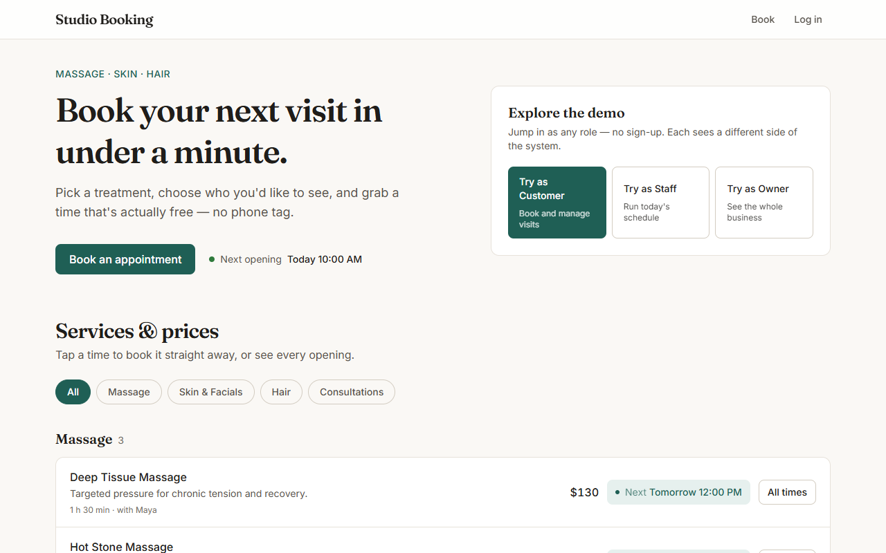

---

## Contents

- [Highlights](#highlights)
- [Features](#features)
- [Screenshots](#screenshots)
- [Architecture](#architecture)
- [How a booking works](#how-a-booking-works)
- [Data model](#data-model)
- [Engineering decisions](#engineering-decisions)
- [Tech stack](#tech-stack)
- [Testing and CI](#testing-and-ci)
- [Running locally](#running-locally)
- [Configuration](#configuration)
- [Deployment](#deployment)
- [API overview](#api-overview)
- [Project structure](#project-structure)
- [Using it for your business](#using-it-for-your-business)

## Highlights

- **Double-booking is impossible, not just unlikely.** A PostgreSQL exclusion constraint (`btree_gist`) rejects overlapping appointments for the same staff member, even when two requests race past the application's checks.
- **Payments that can't lose money or a slot.** Booking holds the slot while the customer pays a deposit. Confirmation is idempotent across the webhook and the return page, a late payment for a slot that was taken meanwhile is refunded automatically, and refunds happen *before* cancellation so a failed refund never leaves a customer cancelled without their money.
- **Swappable payment providers.** Stripe Checkout and a built-in demo provider implement the same interface; the rest of the code doesn't know which one it's talking to.
- **A background worker that's safe to run anywhere.** Reminder emails go out 24 hours ahead from a worker that locks rows with `SELECT … FOR UPDATE SKIP LOCKED`, so parallel workers never double-send, and failures are retried on the next pass.
- **Time-zone correct.** Everything is stored in UTC; working hours are wall-clock times in the business's time zone, so a 9:00 shift stays at 9:00 across daylight-saving changes.
- **Built to be shown.** One-click demo roles, guardrails so one visitor can't break the demo for the next, a nightly reset, and clear messages when the free API is still waking up.
- **101 backend tests** plus a type-checked, linted frontend build on every pull request. `main` is protected and deploys automatically.

## Features

### For customers
- **Service menu** grouped by category, with each service's **next opening**. One tap books that exact slot.
- **Real availability** from staff hours, existing bookings, time off, minimum notice and the booking horizon. Pick a person or "any available".
- **Deposits paid online** (Stripe or the demo checkout), with the balance shown as due at the studio.
- **Reschedule or cancel** up to 2 hours before. The deposit carries over when rescheduling and is refunded automatically on cancellation.
- **Reminder email** 24 hours before, with the local time, the balance due and a link to manage the booking.
- Booking state lives in the URL, so a half-finished booking survives logging in.

### For staff
- **Day view** of their schedule: confirm, mark done, record no-shows, reschedule, cancel. Empty days point to the next day with bookings.
- **Self-service availability:** weekly shifts (several per day, for breaks) and time off. Overlapping shifts are flagged as you type; new hours list any bookings they'd leave outside (which stay booked); time off that clashes with bookings is refused, with those bookings linked for rescheduling.

### For owners
- **Dashboard:** today's appointments, the next 14 days, revenue month-to-date plus what's already booked, cancellation and no-show rate, a bookings chart, top services and staff load.
- **Every booking** with filters by time range, staff member and status, including deposits, refunds and reminder status.
- **Any staff member's hours and time off**, from the same page staff use.
- **Django admin** for services, prices, deposits and staff.

## Screenshots

| Booking with a deposit | Demo checkout |
| --- | --- |
| 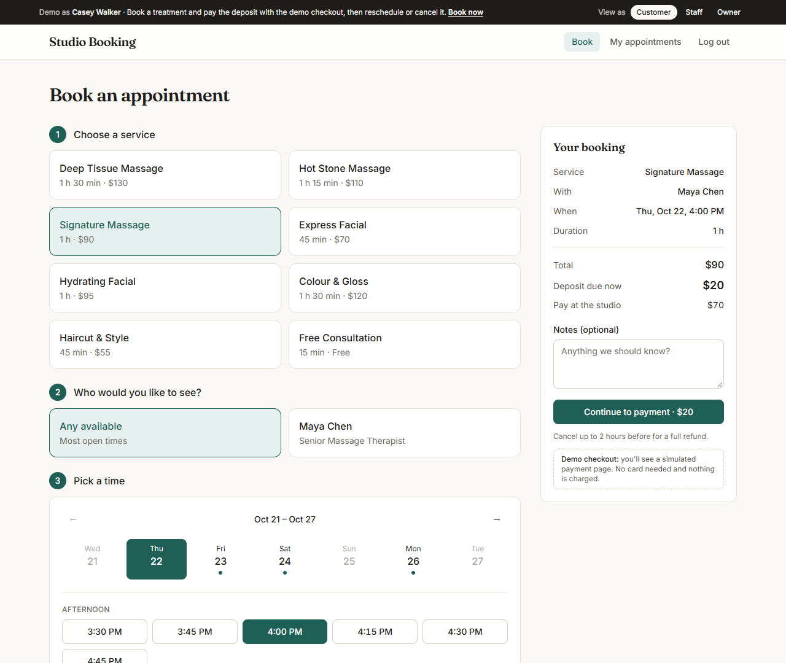 | 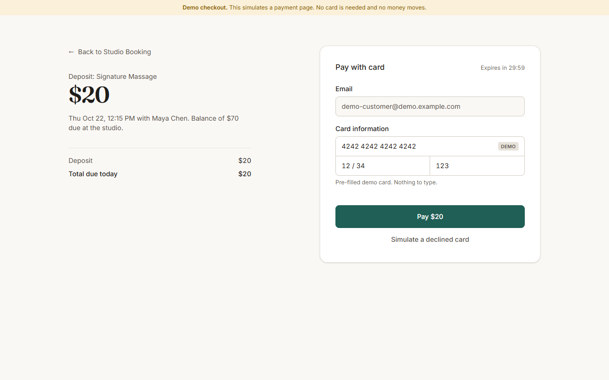 |
| **Customer's appointments** | **Rescheduling** |
| 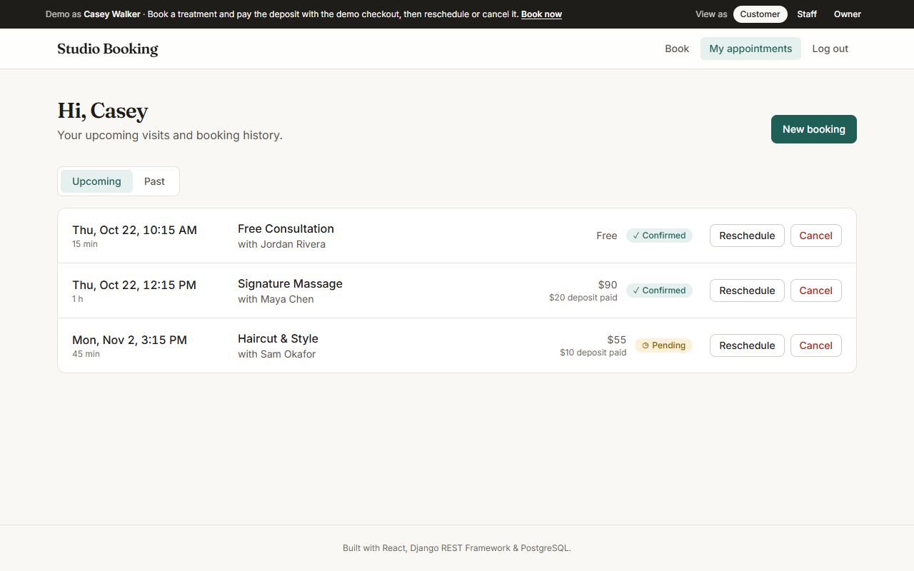 | 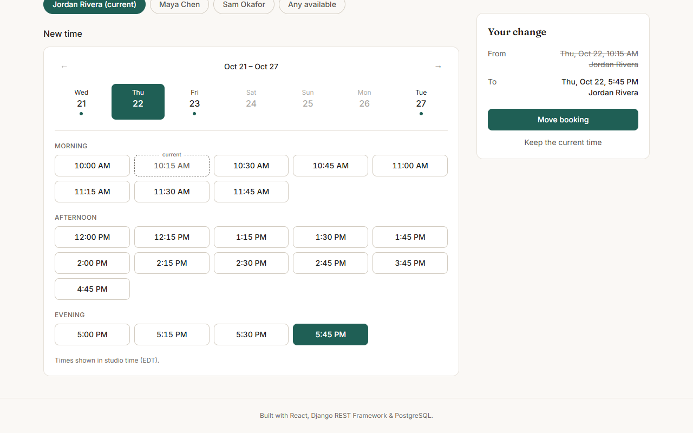 |
| **Staff schedule** | **Staff availability** |
| 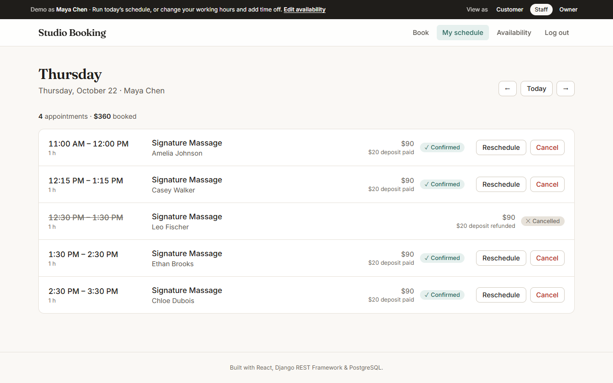 | 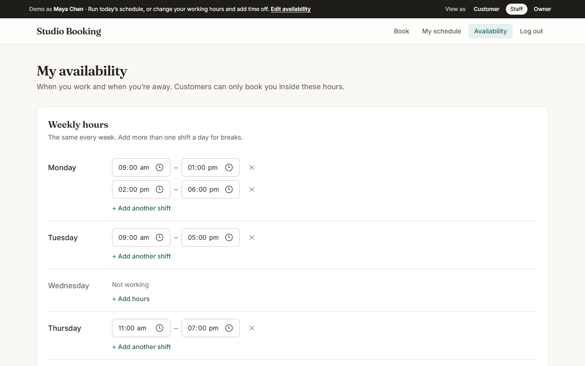 |
| **Owner dashboard** | **Dark mode** |
| 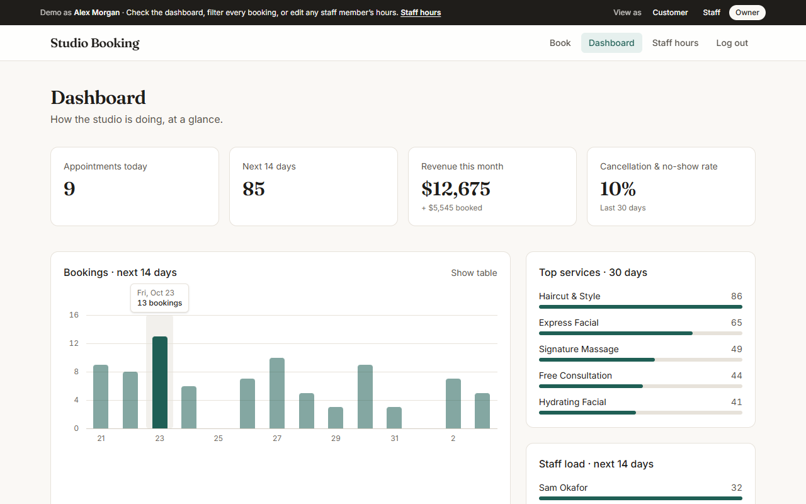 | 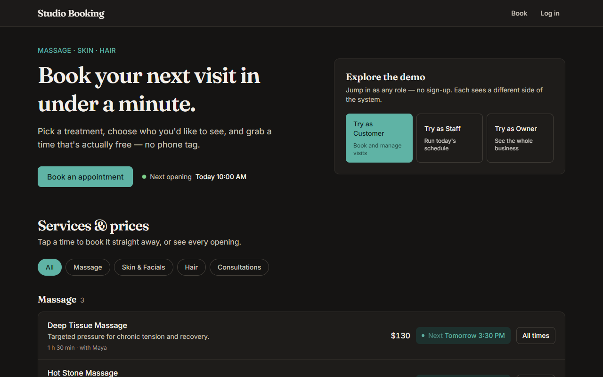 |

<p align="center">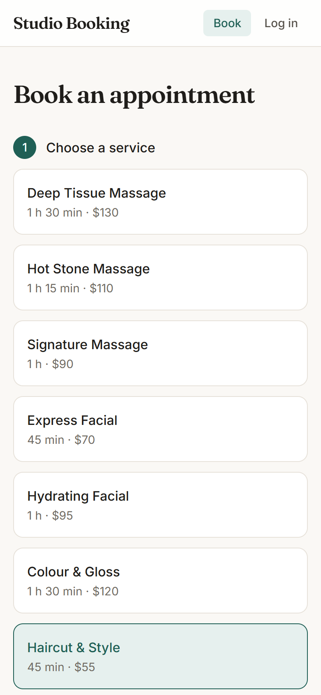</p>

## Architecture

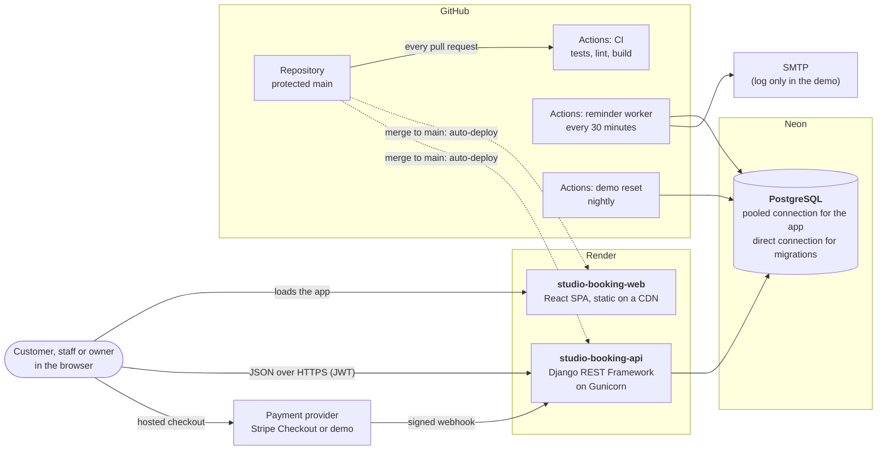

The frontend is a static single-page app that talks to the API directly; the API only accepts the frontend's origin (CORS). Background work runs outside the request cycle: on free hosting it's scheduled by GitHub Actions, and on a host with always-on workers the same command runs as `send_reminders --loop`.

```
backend/
├── accounts/     custom User (customer · staff · admin), JWT auth, one-click demo login
├── scheduling/
│   ├── models.py          Service, StaffMember, WorkingHours, TimeOff, Appointment (+ exclusion constraint)
│   ├── availability.py    slot engine: hours − bookings − time off, in the business time zone
│   ├── reminders.py       reminder selection, locking and emails
│   ├── staff_views.py     staff self-service: hours and time off
│   └── views.py           booking, rescheduling, role-scoped querysets, dashboard
└── payments/
    ├── services.py        hold → checkout → confirm / expire → refund
    └── providers/         stripe_provider.py · demo.py (same interface)
```

## How a booking works

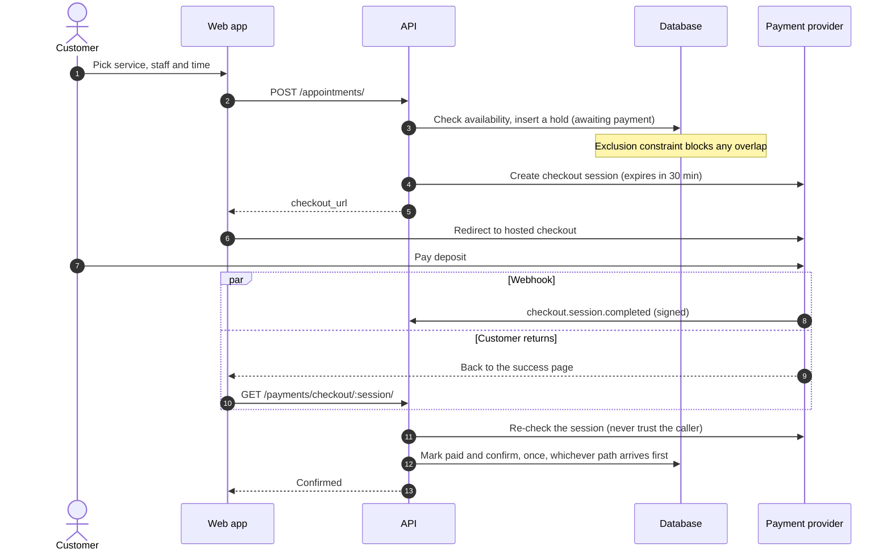

If the customer abandons the checkout, the hold lapses after 35 minutes and the slot is freed. If a slow payment lands after someone else has taken the slot, the constraint refuses to confirm it and the deposit is refunded.

### Appointment lifecycle

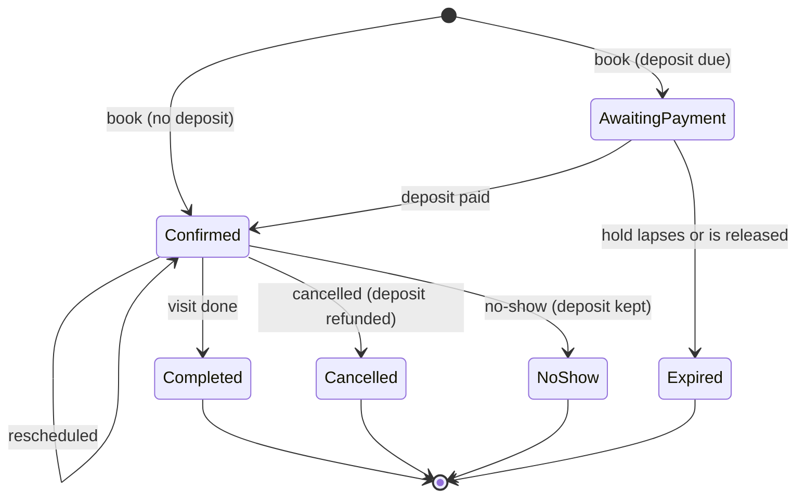

Only active bookings (awaiting payment or confirmed) occupy a staff member's calendar, and the exclusion constraint applies to exactly those.

## Data model

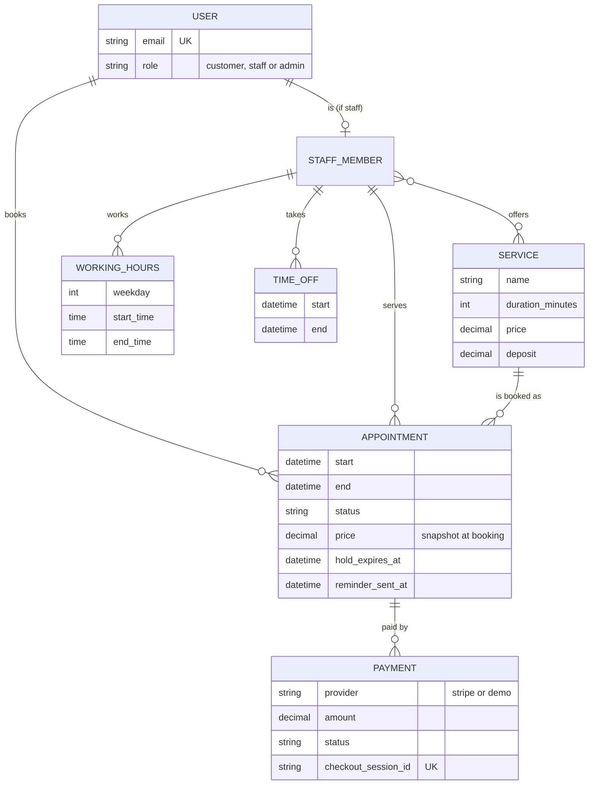

## Engineering decisions

| Decision | Why |
| --- | --- |
| **Overlap protection in the database** (`EXCLUDE USING gist (staff WITH =, tstzrange(start, end) WITH &&)`) | Application checks give friendly `409` errors; the constraint is the guarantee, so concurrent requests can never double-book. |
| **Availability is computed, never stored** | No slot table to keep in sync; changing someone's hours affects bookings immediately. The public service list finds every service's next opening in a fixed 7 queries, however many services there are. |
| **Prices are copied onto each appointment** | Changing a price never rewrites history or revenue figures. |
| **Role-scoped querysets** | Customers only ever query their own bookings and staff their own; authorization lives in one place. |
| **Idempotent payment confirmation from two sources** | Works even if the webhook is delayed or never arrives, and can't confirm twice. |
| **Refund first, then cancel** | A provider outage leaves the booking untouched instead of cancelling without a refund. |
| **Reminder worker with `SKIP LOCKED`** | Safe to run on a schedule, repeatedly, or as several workers; an SMTP failure is retried, not lost. |
| **Never cancel silently** | New staff hours report bookings left outside them; time off refuses to overlap bookings and lists them. |
| **Demo guardrails** | Demo accounts can't clear all working hours or take more than a week off, so the shared demo stays bookable. |
| **Neon pooled + direct connections** | The app uses the pooler (server-side cursors off, health checks on for scale-to-zero); migrations use the direct connection. |

## Tech stack

| Layer | Choice |
| --- | --- |
| Frontend | React 19, TypeScript, Vite, TanStack Query, React Router, Tailwind CSS v4 |
| Backend | Python 3.14, Django 6, Django REST Framework, SimpleJWT, Gunicorn |
| Database | PostgreSQL on Neon, `btree_gist` exclusion constraint |
| Payments | Stripe Checkout with signed webhooks, or the built-in demo provider |
| Email | Django email over SMTP, HTML and plain-text templates |
| Infrastructure | Render (API and static site), Neon, GitHub Actions (CI, reminders, nightly reset), Docker Compose for local Postgres |
| Quality | Django test runner, oxlint, type-checked production build, branch protection on `main` |

## Testing and CI

```bash
cd backend && python manage.py test           # 101 tests
cd frontend && npm run lint && npm run build  # lint, type-check, production build
```

| Area | Tests | Covers |
| --- | ---: | --- |
| Payments | 29 | Holds, checkout, idempotent confirmation, late payments, refunds, webhooks, the demo provider end to end |
| Booking core | 23 | Exclusion constraint, availability, permissions, cancellation rules |
| Staff self-service | 17 | Shift validation, time off in business time, clash detection, permissions, demo guardrails |
| Rescheduling | 11 | Moving into its own slot, clashes, switching staff, the cutoff, re-armed reminders |
| Reminders | 9 | Selection window, once-only sending, retries, demo suppression, command exit codes |
| Accounts | 8 | Registration, demo login, privacy of real users on the public demo |
| Performance and routing | 4 | Constant query count for the service list, the API root redirect |

Every pull request runs the backend tests against a real PostgreSQL service and builds the frontend. `main` requires a pull request with both checks passing.

## Running locally

Requirements: Python 3.12+, Node 20+, Docker.

```bash
# Database
docker compose up -d

# API → http://localhost:8000
cd backend
python -m venv .venv
.venv/Scripts/activate              # macOS/Linux: source .venv/bin/activate
pip install -r requirements.txt
cp .env.example .env                # then set SECRET_KEY
python manage.py migrate
python manage.py seed_demo          # services, staff, customers, ~6 weeks of bookings and deposits
python manage.py runserver

# Reminder worker (optional, in another terminal)
python manage.py send_reminders --loop

# Web app → http://localhost:5173
cd frontend
npm install
npm run dev
```

Then open http://localhost:5173/demo/owner (or `/demo/customer`, `/demo/staff`) to start in a role.

## Configuration

Every setting is documented, with safe local defaults, in [`backend/.env.example`](backend/.env.example) and [`frontend/.env.example`](frontend/.env.example). Copy the backend one to `backend/.env` to get started; empty values fall back to the defaults.

| Variable | Used by | Purpose |
| --- | --- | --- |
| `DATABASE_URL`, `DATABASE_URL_UNPOOLED` | API | App connection (pooled) and migrations (direct) |
| `SECRET_KEY`, `DEBUG`, `ALLOWED_HOSTS` | API | Django basics |
| `CORS_ALLOWED_ORIGINS`, `FRONTEND_URL` | API | Which site may call the API; where checkout and emails link back to |
| `DEMO_MODE` | API | One-click demo logins and demo guardrails |
| `BUSINESS_NAME`, `BUSINESS_TIMEZONE` | API | Branding and the time zone working hours are read in |
| `PAYMENT_PROVIDER` | API | `stripe`, `demo` or `none` (default: Stripe if a key is set, else demo in demo mode) |
| `STRIPE_SECRET_KEY`, `STRIPE_WEBHOOK_SECRET` | API | Stripe Checkout and webhook verification |
| `EMAIL_HOST`, `EMAIL_HOST_USER`, `EMAIL_HOST_PASSWORD`, `DEFAULT_FROM_EMAIL` | API, worker | SMTP; without `EMAIL_HOST` emails are logged instead of sent |
| `VITE_API_URL` | Web app (build time) | The API's public URL |

## Deployment

| Part | Where | How |
| --- | --- | --- |
| Web app | Render static site (CDN) | `render.yaml` → `studio-booking-web`, built with `npm ci && npm run build`, SPA rewrite |
| API | Render web service (Ohio) | `render.yaml` → `studio-booking-api`; `backend/build.sh` migrates over the direct connection, then Gunicorn |
| Database | Neon PostgreSQL (Ohio) | Same region as the API |
| Reminder worker | GitHub Actions, every 30 minutes | `.github/workflows/send-reminders.yml` |
| Demo reset | GitHub Actions, nightly | `.github/workflows/reset-demo.yml`; `seed_demo` keeps IDs stable so shared links keep working |

Merging to `main` deploys both services. For Stripe webhooks in development: `stripe listen --forward-to localhost:8000/api/payments/stripe/webhook/`.

## API overview

| Method | Endpoint | Who |
| --- | --- | --- |
| `GET` | `/api/services/` · `/api/staff/?service=` · `/api/availability/?service=&from=&to=[&staff=]` | public |
| `POST` | `/api/auth/register/` · `/api/auth/login/` · `/api/auth/demo-login/` | public |
| `GET/POST` | `/api/appointments/?scope=upcoming\|past&date=&status=` | signed in, role-scoped |
| `POST` | `/api/appointments/{id}/reschedule/` · `…/cancel/` | the customer (before the cutoff), staff, owner |
| `POST` | `/api/appointments/{id}/confirm/` · `…/complete/` · `…/no-show/` | staff (own), owner |
| `POST` | `/api/appointments/{id}/pay/` · `GET /api/payments/checkout/{session}/` | the customer |
| `POST` | `/api/payments/stripe/webhook/` | Stripe (signature-verified) |
| `GET/PUT` | `/api/staff/{id}/hours/` | that staff member, owner |
| `GET/POST/DELETE` | `/api/staff/{id}/time-off/[{id}/]` | that staff member, owner |
| `GET` | `/api/dashboard/` | owner |

## Project structure

```
.
├── backend/                 Django project (config/, accounts/, scheduling/, payments/)
├── frontend/                React + TypeScript app (pages/, components/, api/, lib/)
├── docs/screenshots/        Images used in this README
├── .github/workflows/       ci.yml · send-reminders.yml · reset-demo.yml
├── render.yaml              Render Blueprint for the API and the static site
├── neon.ts                  Neon project config
└── docker-compose.yml       Local PostgreSQL
```

## Using it for your business

Studio Booking is built to run a real appointment business, not just to demo one. It can be set up with your services, prices, deposits, staff and opening hours, your branding and domain, Stripe payouts to your own account, and real reminder emails. If you'd like it for your business, get in touch through my [GitHub profile](https://github.com/SabeehAnsari).

### Ideas on the roadmap
- SMS reminders and Google Calendar sync for staff
- Multiple locations
- Customer visit history and notes
- A waitlist for fully booked days

---

© Sabeeh Ansari. The source is published for review; all rights reserved.
