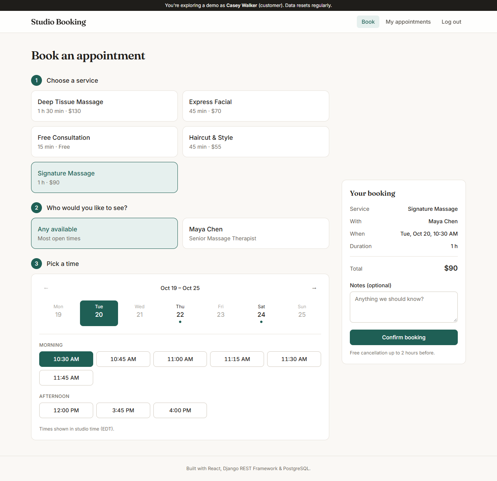

# Studio Booking

An appointment booking system for service businesses (salons, clinics, studios). Customers book online, staff run their day from a schedule view, and owners see the business at a glance.

**Live demo: [studio-booking-web.onrender.com](https://studio-booking-web.onrender.com)** · One-click demo logins for customer, staff and owner. No sign-up needed.

> The API runs on a free instance that sleeps when idle, so the first visit can take up to a minute to wake it. Demo data resets every night.



## Features

- **Real availability.** Bookable slots are computed from each staff member's weekly hours, existing appointments, time off, minimum notice and how far ahead you can book.
- **No double-booking, guaranteed by the database.** A PostgreSQL exclusion constraint rejects overlapping appointments for the same staff member, even if two requests race past the application check.
- **Time-zone correct.** Everything is stored in UTC. Working hours are wall-clock times in the business time zone, so a 9:00 shift stays at 9:00 across DST changes, and visitors see studio time wherever they are.
- **Three roles**
  - *Customer:* book, view upcoming and past visits, cancel up to a cutoff
  - *Staff:* day-by-day schedule; confirm, complete, mark a no-show or cancel
  - *Owner:* KPIs, a 14-day booking chart, top services, staff load, and every appointment with filters
- **Deposits paid online.** Each service can require a deposit. Booking holds the slot (`awaiting_payment`) and sends the customer to a hosted checkout. Payment confirms the booking; an abandoned checkout frees the slot after 35 minutes. Cancelling a paid booking refunds the deposit automatically, while no-shows keep it.
- **Swappable payment providers.** **Stripe Checkout** is used when `STRIPE_SECRET_KEY` is set. Otherwise a built-in **demo provider** runs the same flow end to end (hosted checkout page, a simulated declined card, refunds) with no account and no money moving. The live demo uses the demo provider.
- **"Any available" staff.** Customers can pick a person or take the first free one.
- **Shareable booking state.** The service, staff, day and slot live in the URL, so the selection survives the login redirect.
- **Django admin** for managing services, staff, working hours and time off.

## Tech stack

| Layer | Choice |
| --- | --- |
| Frontend | React 19, TypeScript, Vite, TanStack Query, React Router, Tailwind CSS v4 |
| Backend | Django 6, Django REST Framework, SimpleJWT |
| Payments | Stripe Checkout + webhooks, or the built-in demo provider |
| Database | PostgreSQL 17 (`btree_gist` exclusion constraint) |
| Tooling | Docker Compose, GitHub Actions CI, oxlint |

## Architecture

```
React SPA ──/api──▶ Django REST API ──▶ PostgreSQL
  (Vite)              │                    └─ EXCLUDE USING gist (staff WITH =, tstzrange WITH &&)
                      ├─ accounts/      custom User (admin · staff · customer), JWT auth, demo login
                      ├─ payments/      deposits: hold → checkout → confirm/expire → refund
                      │    └─ providers/   stripe_provider.py · demo.py (same interface)
                      └─ scheduling/
                           ├─ models.py         Service, StaffMember, WorkingHours, TimeOff, Appointment
                           ├─ availability.py   slot engine (pure function of hours − bookings − time off)
                           ├─ views.py          REST endpoints + role-scoped querysets
                           └─ tests.py          constraint, availability, permissions, cancellation rules
```

### Key decisions

- **Two layers of protection against double-booking.** The API checks availability first so it can return a friendly `409 Conflict`. The database constraint is the real guarantee. When it fires, the `IntegrityError` is turned into the same 409.
- **Availability is computed, not stored.** No pre-generated slot table to keep in sync. Changing someone's hours takes effect immediately.
- **Payment confirmation is idempotent and comes from two places.** The provider's webhook and the customer's return to the success page both call `fulfill_checkout`, which re-checks the session with the provider and confirms the booking once. It works even if the webhook is delayed or never arrives (e.g. local development).
- **Late payments can't double-book.** If a hold lapses and someone else takes the slot before a slow payment lands, the exclusion constraint refuses to confirm it and the deposit is refunded automatically.
- **Refund first, then cancel.** If the refund fails, the booking stays as it was, so no customer is left cancelled without their money back.
- **Prices are copied onto each appointment**, so changing a service's price never rewrites revenue history.
- **Role-scoped querysets.** Customers only ever query their own appointments and staff only their own. Admins see everything. Authorization lives in one place, not in every view.

## API overview

| Method | Endpoint | Who |
| --- | --- | --- |
| `GET` | `/api/services/`, `/api/staff/?service=` | public |
| `GET` | `/api/availability/?service=&from=&to=[&staff=]` | public |
| `POST` | `/api/auth/register/`, `/api/auth/login/`, `/api/auth/demo-login/` | public |
| `GET/POST` | `/api/appointments/?scope=upcoming\|past&date=&status=` | signed in (role-scoped) |
| `POST` | `/api/appointments/{id}/cancel/` | owner of the booking (before cutoff), staff, admin |
| `POST` | `/api/appointments/{id}/confirm/` · `complete/` · `no-show/` | staff (own), admin |
| `POST` | `/api/appointments/{id}/pay/` | customer: reopen checkout for an unpaid hold |
| `GET` | `/api/payments/checkout/{session_id}/` | customer: confirm payment on return from checkout |
| `POST` | `/api/payments/stripe/webhook/` | Stripe (signature-verified) |
| `GET` | `/api/dashboard/` | admin |

## Running locally

Requirements: Python 3.12+, Node 20+, Docker.

```bash
# 1. Database
docker compose up -d

# 2. Backend  (http://localhost:8000)
cd backend
python -m venv .venv
.venv/Scripts/activate            # macOS/Linux: source .venv/bin/activate
pip install -r requirements.txt
cp .env.example .env              # then set SECRET_KEY
python manage.py migrate
python manage.py seed_demo        # services, staff, customers and ~6 weeks of bookings
python manage.py createsuperuser  # optional, for /admin
python manage.py runserver

# 3. Frontend  (http://localhost:5173)
cd frontend
npm install
npm run dev
```

### Payments

| `PAYMENT_PROVIDER` | Behaviour |
| --- | --- |
| *(unset)* | `stripe` if `STRIPE_SECRET_KEY` is set, else `demo` when `DEMO_MODE=True`, else `none` |
| `stripe` | Stripe Checkout. Set `STRIPE_SECRET_KEY`, plus `STRIPE_WEBHOOK_SECRET` in production |
| `demo` | Simulated checkout page; nothing is charged |
| `none` | No deposits; bookings confirm immediately |

For Stripe webhooks in development: `stripe listen --forward-to localhost:8000/api/payments/stripe/webhook/`.

Run the tests with `python manage.py test` (backend) and `npm run lint && npm run build` (frontend).

`seed_demo` wipes and recreates all demo data, with stable IDs. Schedule it nightly on a public demo so visitors always start from a clean state.

## Deployment

| Part | Where | How |
| --- | --- | --- |
| Frontend | Render static site (CDN) | `render.yaml` → `studio-booking-web`, built with `npm ci && npm run build` |
| API | Render web service (Ohio) | `render.yaml` → `studio-booking-api`, `backend/build.sh` then Gunicorn |
| Database | Neon Postgres (Ohio) | App traffic over the pooled connection; migrations over the direct one |
| Demo reset | GitHub Actions | `.github/workflows/reset-demo.yml`, nightly at 3 AM studio time |

Pushing to `main` deploys both services. Configuration lives in environment variables: the frontend needs `VITE_API_URL`; the API needs `DATABASE_URL`, `DATABASE_URL_UNPOOLED`, `CORS_ALLOWED_ORIGINS` and `FRONTEND_URL` (see `render.yaml`).

## Roadmap

- [x] Online deposits (Stripe or demo provider), with automatic refunds
- [ ] Email reminders 24 hours before (background worker)
- [ ] Customer rescheduling
- [ ] Staff self-service for working hours and time off
